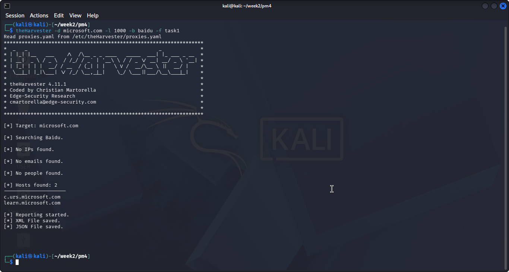
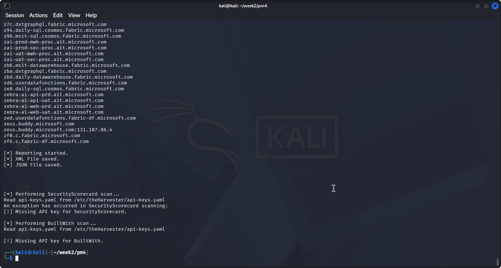
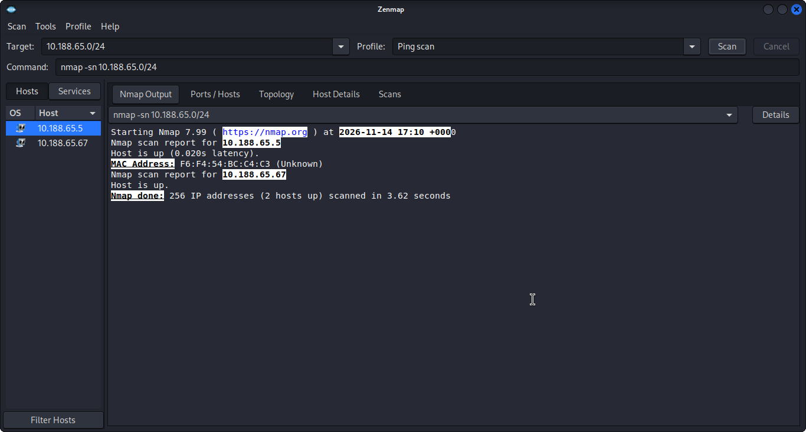
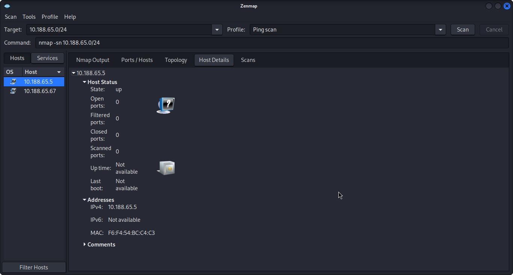
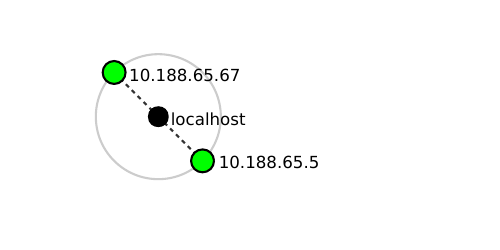

# Week 2: Footprinting & Network Scanning (Cybersecurity Internship)

## Objective
Complete one elective footprinting module and both essential modules for Week 2 of the Networkwalks Cybersecurity Internship: OSINT footprinting with theHarvester (W2-PM4) and network scanning with Zenmap (W2-PM5).

## What I did
- Used theHarvester in Kali Linux to footprint microsoft.com via Baidu, then via all supported sources
- Used Zenmap to scan my own mobile hotspot network, identifying live hosts, IP/MAC addresses, and generating a topology map
- Documented everything in a full penetration testing report, including a liability disclaimer and risk analysis

## Commands used
```bash
theHarvester -d microsoft.com -l 1000 -b baidu -f task1
theHarvester -d microsoft.com -l 50 -b all -f task2
nmap -sn 10.188.65.0/24   # run via Zenmap's Ping Scan profile
```

## Screenshots


*theHarvester against microsoft.com via Baidu (limit 1000) — 2 hosts found.*


*theHarvester against microsoft.com via all sources (limit 50) — larger set of subdomains found.*


*Zenmap ping scan of 10.188.65.0/24 — 2 hosts up out of 256 addresses scanned.*


*Host Details for 10.188.65.5, showing its MAC address.*


*Zenmap Topology Legend, reviewed before interpreting the network map.*


*Network topology for 10.188.65.0/24 — localhost connected to the two discovered hosts.*

## Full report
See [W2-PM-FINAL-Report-Ibrahim-Jalloh.docx](W2-PM-FINAL-Report-Ibrahim-Jalloh.docx) for the complete penetration testing report: liability disclaimer, introduction, tools used, activities performed, risk analysis, recommendations and conclusion.

## Modules completed
| Module | Status |
|---|---|
| W2-PM4 (theHarvester) | Done |
| W2-PM5 (Zenmap) | Done |
| W2-PM1 / PM2 / PM3 (other electives) | Not attempted due to time constraints; may revisit independently |

## Environment
Kali Linux, booted from a live USB with persistence enabled, due to hardware virtualization being locked in my laptop's BIOS (see Week 1 repo for details on this limitation).

## Scope note
All footprinting was performed against microsoft.com, a public example domain used per the lab's instructions, using public OSINT sources only. All network scanning was performed only against my own mobile hotspot network, which I own and control, in line with my signed Letter of Authorization. No exploitation or unauthorized access was performed at any point.
